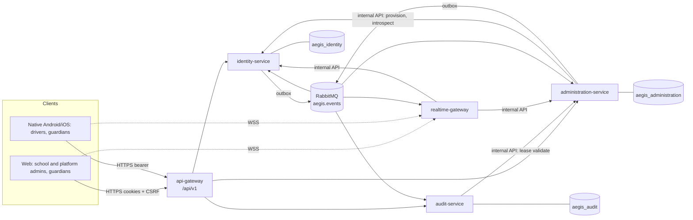
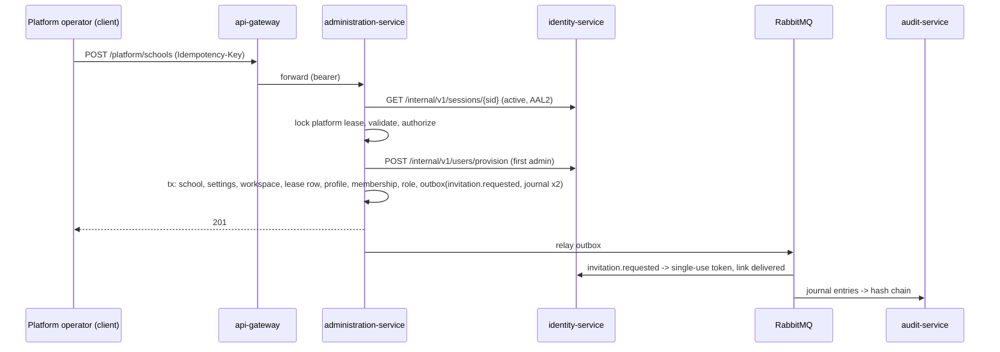

# Architecture overview

Decision record: [ADR-0001](../decisions/ADR-0001-microservice-architecture.md). Service ownership: [service catalog](service-catalog.md).

## System context

Phase 2 and later add `school-setup-service`, `trip-service`, `tracking-service`, and `notification-service` on the same pattern.

## Request path and trust boundaries

1. **Gateway: filters and forwards, never grants access.** It applies TLS (at the load balancer), size limits, rate limits, CORS, and CSRF. It turns the web `aegis_at` cookie into a bearer header. It blocks `/internal/*` and strips any `x-service-token` sent by callers.
2. **Owning service: authenticates and authorizes.** It verifies the ES256 access token against the identity JWKS. Then it authorizes with `packages/domain` policy, using data it loads itself, never data from the client.
3. **Privileged commands: checked under the lease.** The service confirms with identity-service that the session is still active and at AAL2. It then locks the workspace lease row, validates it, and runs the mutation and its journal outbox record in one transaction.
4. **Database: row-level security as defense in depth.** PostgreSQL RLS scopes the runtime role to the tenant context set at the start of the transaction.

## Data flows for Phase 1

### School provisioning

The platform operator holds the platform lease.

### Invitation acceptance

The invitee opens the link and the client calls `/auth/invitations/redeem`. A code goes to the invited contact. `/auth/otp/verify` then activates the identity and publishes `identity.invitation.accepted`. `administration-service` consumes that event and activates the profile and membership.

### Logout and revocation

identity-service revokes the session and publishes `identity.session.revoked`.

- **administration-service** ends any lease the session held (`LOGOUT` or `SESSION_REVOKED`), journals it, and publishes `administration.lease.changed`.
- **realtime-gateway** disconnects the session's sockets and drops privileged subscriptions.

Independently, every later privileged command rechecks the session synchronously, so revocation takes effect immediately even before the events arrive.

## Consistency rules

| Invariant                                  | Mechanism                                                                                                               |
| ------------------------------------------ | ----------------------------------------------------------------------------------------------------------------------- |
| One active operator per workspace          | One lease row per workspace, locked with `SELECT … FOR UPDATE`; database clock; tested with concurrent requests         |
| Privileged command runs under a live lease | Lease validated and touched inside the command's transaction while holding the row lock                                 |
| Downstream services reject stale holders   | Strictly increasing fencing token per grant (ADR-0003)                                                                  |
| Privileged mutation always journaled       | Journal record staged in the producer's outbox in the same transaction; idempotent hash-chained append in audit-service |
| Journal cannot be edited                   | No UPDATE/DELETE grants; triggers reject UPDATE, DELETE, and TRUNCATE; per-workspace SHA-256 chain with verifier        |
| Tenant isolation                           | Server-derived scope; strict request contracts; RLS on school-owned tables; non-owner runtime roles without BYPASSRLS   |
| Events processed once                      | Inbox table keyed by (event_id, consumer) claimed in the effect's transaction                                           |

## Deployment units

Each service ships one image with two commands: `node dist/main.js` (API) and `node dist/worker.js` (outbox relay, consumers, housekeeping). The two scale independently. `api-gateway` and `realtime-gateway` have no worker. See [ADR-0014](../decisions/ADR-0014-deployment.md).
